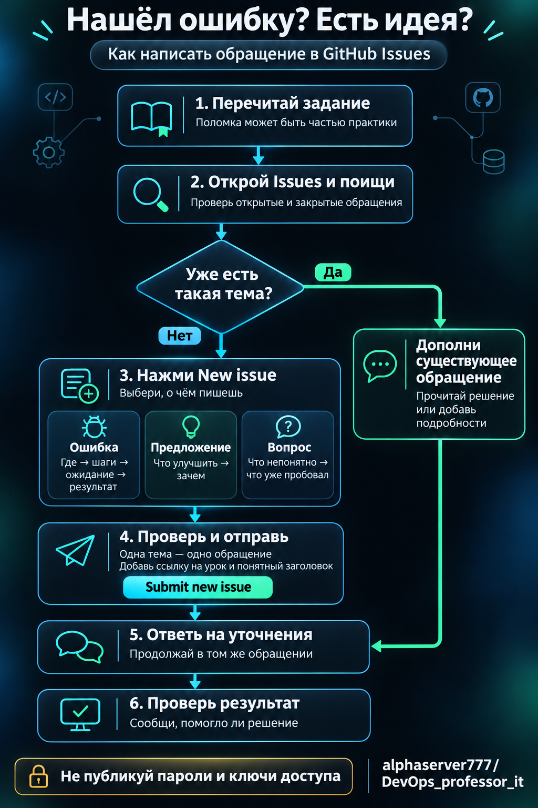

# Нашёл ошибку или хочешь предложить улучшение? Напиши в Issues

Памятка для учеников [DevOps Professor IT](https://github.com/alphaserver777/DevOps_professor_it).

**Issues — раздел обращений на GitHub.** Одно обращение — отдельная страница с заголовком, описанием и обсуждением. Здесь можно сообщить об ошибке в задании, предложить улучшение или попросить пояснить непонятное место.

Достаточно браузера и учётной записи GitHub. Устанавливать Git и скачивать проект для отправки обращения не нужно. Пиши по-русски, своими словами. Не обязательно знать причину ошибки: достаточно понятно описать, что произошло.

**Короткий путь:** проверь задание → найди похожее обращение → дополни его или создай своё → ответь на уточнения → проверь результат.

## 1. Определи, о чём хочешь написать

| Что случилось | Что написать |
| --- | --- |
| Команда из урока не выполняется, ссылка не открывается, в тексте опечатка или противоречие | **Ошибка:** где она находится и как её увидеть |
| Не хватает примера, пояснения или удобного способа выполнить задание | **Предложение:** что добавить и чем это поможет ученикам |
| Не понимаешь условие или не можешь продолжить после своих попыток | **Вопрос:** на каком шаге остановился и что уже попробовал |

В курсе встречаются **намеренные поломки**: задание специально предлагает сломать программу, найти причину и восстановить работу. Сначала перечитай условие и раздел с типичными ошибками, если он есть. Если поведение соответствует заданию, это ожидаемая часть практики.

Если сомневаешься, напиши вопрос: «Не понимаю, это ожидаемая поломка или ошибка в инструкции». Угадывать не нужно.

## 2. Проверь, не написал ли об этом кто-то раньше

1. Войди в свою учётную запись на [GitHub](https://github.com/login). Если её ещё нет — сначала зарегистрируйся на сайте.
2. Открой [обращения нашего проекта](https://github.com/alphaserver777/DevOps_professor_it/issues).
3. В строке поиска **внутри раздела Issues** замени весь запрос на `is:issue docker`. Вместо `docker` подставь слово из своей проблемы: название программы, номер урока или часть сообщения об ошибке. Нажми Enter.
4. Посмотри и открытые, и закрытые обращения. Запрос без `is:open` или `state:open` позволяет искать среди обоих состояний.

**Нашёл точно такую же проблему?** Прочитай обсуждение. Возможно, решение уже есть. Если появились полезные подробности, добавь комментарий в найденное обращение: свой шаг, условия и результат. Отдельное обращение о той же проблеме создавать не нужно.

**Обращение закрыто, но проблема повторяется?** Проверь предложенное решение и актуальную версию материалов. Затем опиши результат в том же обсуждении и попроси вернуться к вопросу. Если обсуждение заблокировано и комментарий оставить нельзя, создай новое обращение со ссылкой на прежнее.

**Похожего обращения нет или причина явно другая?** Переходи к следующему шагу. Связанное обращение можно указать ссылкой.

## 3. Создай обращение

Открой [форму нового обращения](https://github.com/alphaserver777/DevOps_professor_it/issues/new). Также можно нажать **New issue** — «Новое обращение» — в разделе Issues.

Если GitHub предложит выбрать образец, выбери подходящий и заполни его. Если сразу открылись поля заголовка и описания, используй заготовки ниже.

### Напиши понятный заголовок

В поле **Title** — «Заголовок» — укажи тип обращения, урок и суть.

- `Ошибка: урок 5.3 — команда запуска магазина завершается сообщением «…»`
- `Предложение: урок 5.3 — добавить пояснение про первый запуск базы`
- `Вопрос: урок 5.3 — как понять, что магазин готов к работе?`

Это примеры заголовков, а не сообщения о подтверждённых ошибках курса. Замени детали на свои. Заголовок «Ничего не работает» не помогает понять, что проверить.

### Заполни описание

**Одно обращение — одна проблема или одна идея.** Несвязанные вопросы отправляй отдельно.

Для ошибки скопируй заготовку и замени подсказки своим текстом:

````text
### Где возникла проблема
Ссылка на урок или файл:
Номер задания, название раздела и конкретный шаг:

### Что я делал
1. Открыл ...
2. Выполнил ...
3. Получил ...

Точная команда, если проблема связана с ней:
```bash
вставь команду сюда
```

### Что должно было произойти по заданию
...

### Что произошло на самом деле
...

Текст ошибки, если он есть:
```text
вставь сообщение целиком, удалив пароли и другие секреты
```

### В каких условиях это произошло
Операционная система и её версия:
Версия программы, связанной с ошибкой, если известна:
Если проблема на странице: браузер, компьютер или телефон:

### Что я уже попробовал
Действие и его результат:
````

Для опечатки или неработающей ссылки достаточно ссылки на страницу, точного места, текущего текста и предлагаемого исправления. Заполнять сведения об операционной системе в таком случае не нужно.

Для предложения:

```text
### Где хочется улучшить
Ссылка на урок или файл и название раздела:

### В чём трудность сейчас
...

### Что предлагаю
...

### Чем это поможет ученикам
...
```

Для вопроса:

```text
### Какое задание выполняю
Ссылка на урок и конкретный шаг:

### Что именно непонятно
...

### Как я понял задание
...

### Что уже попробовал и что получилось
...
```

Не знаешь версию программы или точное название ошибки? Так и напиши. Это не причина отказываться от обращения.

## 4. Приложи то, что поможет разобраться

**Ссылка на материал.** Открой нужный урок или файл и скопируй адрес из строки браузера. Если речь о конкретной фразе, добавь её в описание или укажи название раздела рядом с ней.

**Текст ошибки.** Копируй его из окна команд в описание между строками с тремя обратными кавычками, как в заготовке. Так его можно прочитать и найти поиском. Укажи и команду, после которой он появился.

**Снимок экрана.** Полезен, если съехала страница или не видно кнопки. Перетащи изображение в поле описания либо воспользуйся кнопкой прикрепления файла. Добавь словами, что именно на нём нужно увидеть. Снимок дополняет текст ошибки.

**Перед публикацией убери секреты.** Проект общедоступный: описание и вложения смогут прочитать другие люди. Не прикладывай пароли, ключи доступа, закрытые ключи SSH, личные данные и полный файл `.env`. Секретные значения в нужном фрагменте замени на `[СКРЫТО]`; проверь также снимки экрана.

## 5. Проверь и отправь

- [ ] Указана ссылка на урок и конкретное место.
- [ ] По заголовку понятно, о чём обращение.
- [ ] Для ошибки описаны действия, ожидаемый и фактический результат.
- [ ] Для идеи объяснены предложение и польза; для вопроса — затруднение и свои попытки.
- [ ] В тексте и вложениях нет секретов.
- [ ] Похожее обращение уже поискал.

Нажми **Submit new issue** — «Отправить новое обращение». Если кнопка называется **Create issue**, это «Создать обращение».

После отправки появится страница с номером, например `#12`. Это номер обращения. Сохрани ссылку на страницу, чтобы вернуться к обсуждению. Метки и ответственных, если потребуется, укажет преподаватель; заполнять эти поля самому не обязательно.

## 6. Продолжи обсуждение и проверь результат

Возвращайся на страницу обращения и проверяй ответы. Если преподаватель попросил уточнение, ответь **комментарием в том же обращении**: напиши в нижнем поле и нажми **Comment** — «Добавить комментарий».

- Отвечай на конкретные вопросы: какая команда, какой шаг, какой результат.
- Если разобрался сам, напиши причину и решение. Это поможет следующему ученику.
- Если предложили исправление, повтори шаг по обновлённой инструкции и сообщи: «Проверил, теперь работает» или опиши оставшуюся ошибку.
- Предложение может потребовать обсуждения или не подойти курсу. Объясняй пользу спокойно и по существу.

**Open** означает «Открыто»: обращение ещё рассматривается. **Closed** означает «Закрыто»: обсуждение завершено. Закрытие не всегда означает исправление — прочитай последнее пояснение.

Если твой вопрос решён, сообщи об этом. Своё обращение можно закрыть кнопкой **Close issue** — «Закрыть обращение». Обращение об ошибке в материалах или предложение лучше закрывать после пояснения преподавателя о результате. Не закрывай его только потому, что удалось временно обойти проблему.

## Схема действий



## Ссылки под рукой

- [Все обращения проекта](https://github.com/alphaserver777/DevOps_professor_it/issues)
- [Создать обращение](https://github.com/alphaserver777/DevOps_professor_it/issues/new)
- [Официальная справка GitHub: создание обращения](https://docs.github.com/en/issues/tracking-your-work-with-issues/using-issues/creating-an-issue)
- [Официальная справка GitHub: поиск обращений](https://docs.github.com/en/issues/tracking-your-work-with-issues/using-issues/filtering-and-searching-issues-and-pull-requests)
